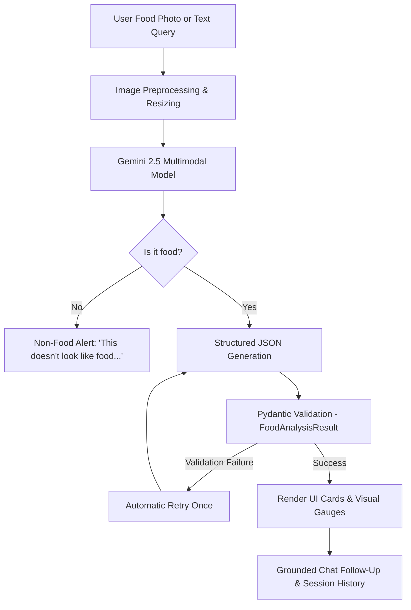

# 🥑 Food Verse AI – Multimodal Food Intelligence Agent

An intelligent, multimodal food intelligence web application built with **Streamlit**, Google's **Gemini 2.5 Multimodal AI (`google-genai` SDK)**, and **Pydantic**. 

Upload any food photograph or type nutritional queries to receive instant culinary identification, macronutrient estimation, allergen safety checks, smart recipe suggestions, healthier alternatives, and grounded conversational follow-up.

---

## 🌟 Key Features

1. **Multimodal Image Analysis**:
   - Accurately detects and classifies dishes, regional cuisine, confidence score, and culinary descriptions.
   - Extracts all prominent ingredients visible and customary in the dish.
   - **Non-Food Guardrail**: Detects non-edible images (e.g. laptops, pets, vehicles) and gracefully warns the user with actionable feedback: *"This doesn't look like food. Please upload an image of a meal, snack, or ingredient."*

2. **Precision Nutrition Breakdown**:
   - Calculates calories (kcal), protein (g), carbohydrates (g), and fat (g) per serving.
   - Computes caloric distribution percentages with visual color-coded progress gauges.
   - Estimates micronutrients: fiber, sugar, sodium, and standard serving size.
   - Provides an **Overall Health Score (1 to 10)** with a clear, one-line justification.

3. **Diet & Allergen Safety Guard**:
   - Classifies dietary category (*Vegetarian, Vegan, Non-Vegetarian, Pescatarian, etc.*).
   - Compliance flags for Gluten-Free, Dairy-Free, Vegetarian, and Vegan status.
   - Identifies major potential allergens (*Dairy, Gluten, Tree Nuts, Peanuts, Eggs, Soy, Shellfish, Fish, Sesame*).
   - Generates actionable allergen warnings and cross-contact advice.

4. **Smart Suggestions & Healthier Alternatives**:
   - Offers **3 distinct healthier alternatives** with explicit calorie differences (e.g. `-110 kcal`), key ingredient substitutions, and nutritional benefits.

5. **Authentic Home Recipes**:
   - Step-by-step cooking instructions with prep time, cook time, servings, and difficulty level.
   - Complete ingredients checklist with measurements.
   - Pro Chef culinary tip to maximize flavor, texture, or nutrition.

6. **Free-Text Dietary Query Mode**:
   - Input custom goals like *"high-protein vegetarian dinner under 500 calories"* or *"low-carb keto lunch under 400 kcal"*.
   - Returns 3 personalized dish recommendations complete with macros, health scores, allergens, and quick recipe steps.

7. **Grounded Interactive Chat Follow-Up**:
   - Ask follow-up questions directly about the active dish (e.g. *"How can I lower sodium?"*, *"What wine or side dish pairs well with this?"*, *"How do I store leftovers?"*).
   - Context is preserved across the conversation, grounded in the dish's ingredients, nutrition, and recipe.

8. **Session History Sidebar**:
   - Persistent session storage in `st.session_state`.
   - Visual thumbnails, dish names, calories, and timestamps.
   - Single-click **"View"** to reload any past analysis and restore its conversation state.
   - Instant Demo presets for immediate testing without requiring an API key.

---

## 🏗️ Architecture & Project Structure

```text
Project/
├── app.py                   # Streamlit web application & modern design system
├── agent.py                 # Gemini multimodal API calls, prompt engineering, retries
├── models.py                # Pydantic schemas for structured JSON validation
├── utils.py                 # Image processing, base64 encoding, JSON sanitizer, presets
├── create_sample_assets.py  # Generator script for test food photos & non-food images
├── sample_images/           # Sample test images (Salmon Bowl, Avocado Toast, Biryani, Laptop)
│   ├── salmon_bowl.jpg
│   ├── avocado_toast.jpg
│   ├── vegetable_biryani.jpg
│   └── laptop_non_food.jpg
├── requirements.txt         # Production dependencies
├── .env.example             # Template for API keys
└── README.md                # Documentation and architecture guide
```

---

## 🧠 How the Multimodal Agent Works



1. **Multimodal Ingestion**:
   The user's uploaded image is normalized to RGB, scaled to optimal dimensions for fast inference, and passed to Gemini via `google.genai.types.Part.from_bytes(...)`.

2. **Strict Schema-Guided Generation**:
   Gemini is configured with `response_mime_type="application/json"` and `response_schema=FoodAnalysisResult`. This guarantees structured responses rather than unpredictable free-form text.

3. **Validation & Automatic Retry**:
   Output is validated against Pydantic models in `models.py`. If a parsing error or schema mismatch occurs, `agent.py` catches it and retries once automatically with an elevated temperature and clarified instructions.

4. **Non-Food Detection**:
   If an uploaded photo contains a non-edible object, the model flags `is_food: false` with a specific reason. The agent intercepts this and raises `NonFoodImageError`, rendering a helpful alert.

---

## 🚀 Getting Started

### 1. Prerequisites
- Python 3.11+
- A Google Gemini API key (Free tier available at [Google AI Studio](https://aistudio.google.com/app/apikey))

### 2. Installation
Clone the repository or navigate to the project directory:

```bash
cd "c:/Users/yuvik/OneDrive/Desktop/Project"
```

Install dependencies:
```bash
pip install -r requirements.txt
```

### 3. Configure API Key
Create a `.env` file from the example:
```bash
cp .env.example .env
```
Add your key inside `.env`:
```ini
GEMINI_API_KEY=your_actual_gemini_api_key_here
```
*(Alternatively, you can paste your API key directly in the web app's sidebar during runtime.)*

### 4. Run the Application
Start the Streamlit development server:
```bash
streamlit run app.py
```
The app will open automatically at `http://localhost:8501`.

---

## 🧪 Testing & Verification

1. **Image Analysis**:
   - Upload any photo or click one of the quick demo buttons in the UI:
     - 🐟 **Salmon Bowl**
     - 🥑 **Avocado Toast**
     - 🍚 **Veg Biryani**
   - Click **"Analyze Food with Multimodal AI"** to see the full breakdown.

2. **Non-Food Guardrail Test**:
   - Click the **💻 Non-Food Test** demo button (image of a laptop computer).
   - Notice the guardrail message: *"This doesn't look like food. Please upload an image of a meal, snack, or ingredient."*

3. **Interactive Grounded Chat**:
   - After analyzing any dish, scroll to the bottom chat box.
   - Click one of the quick suggestions or type your own question (e.g. *"Can I substitute the protein for tofu?"*).
   - Observe how the agent responds using the specific ingredients and macros of the dish.

4. **Text Query Mode**:
   - Switch to the **Smart Meal Text Query** tab.
   - Enter *"high-protein vegetarian dinner under 500 calories"*.
   - View 3 tailored recipes with full nutritional profiles.

---

## 📸 Screenshots & UI Preview

| Section | Description |
| :--- | :--- |
| **Hero & Navigation** | Dark-mode emerald aesthetic with status pills, session history, and quick preset loaders. |
| **Dish Overview & Score** | Dish name, cuisine badge, culinary summary, confidence meter, and circular Health Score badge. |
| **Nutrition Breakdown** | Big macro cards (Calories, Protein, Carbs, Fat) with a three-color caloric ratio bar and micronutrients. |
| **Allergen Guard** | Dietary category badges, detected allergen tags, and caution warning summary. |
| **Healthier Alternatives** | 3 side-by-side alternative cards showing substitutions and calorie delta. |
| **Authentic Home Recipe** | Cooking metrics, ingredients checklist with measurements, numbered steps, and Chef tip. |
| **Grounded Chat** | Conversational message log with quick chip prompts grounded in the analyzed dish. |

---

## 🔒 Security & Best Practices
- API keys are handled securely via `.env` or password-masked sidebar input.
- Large images are client-side resized before upload to reduce latency and memory footprint.
- Robust exception handling wraps all API calls, preventing unhandled crashes.
